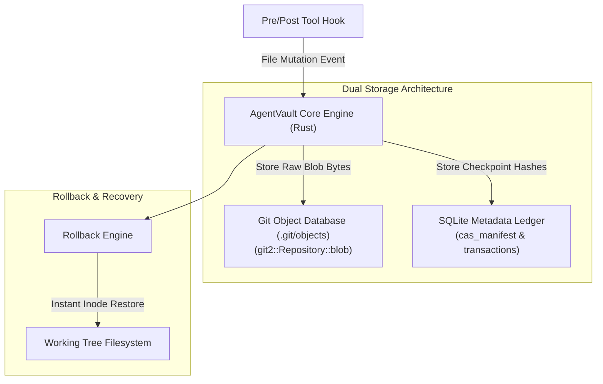

# Architecture Specification: AgentVault

## 1. System Architecture Diagram

---

## 2. Component Blueprint
- **`src/lib.rs` / `src/main.rs`**: Core ledger entry points and CLI command parser.
- **`src/storage/`**: Native Git ODB integration via `libgit2` bindings.
- **`src/db/`**: SQLite transaction tracker maintaining checkpoint metadata.
- **`tests/v4_production_suite.rs`**: Verification suite for drift detection and instant rollbacks.
